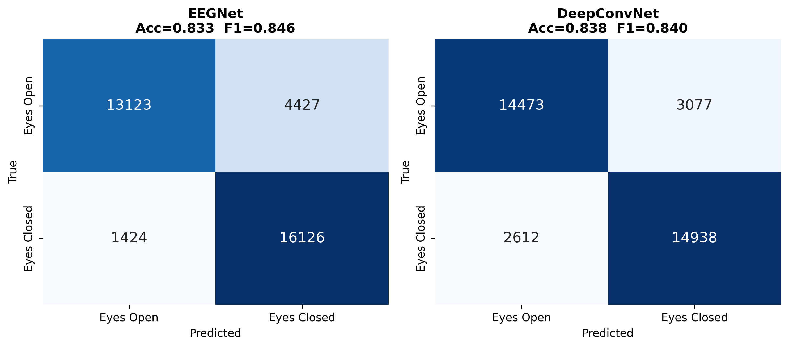
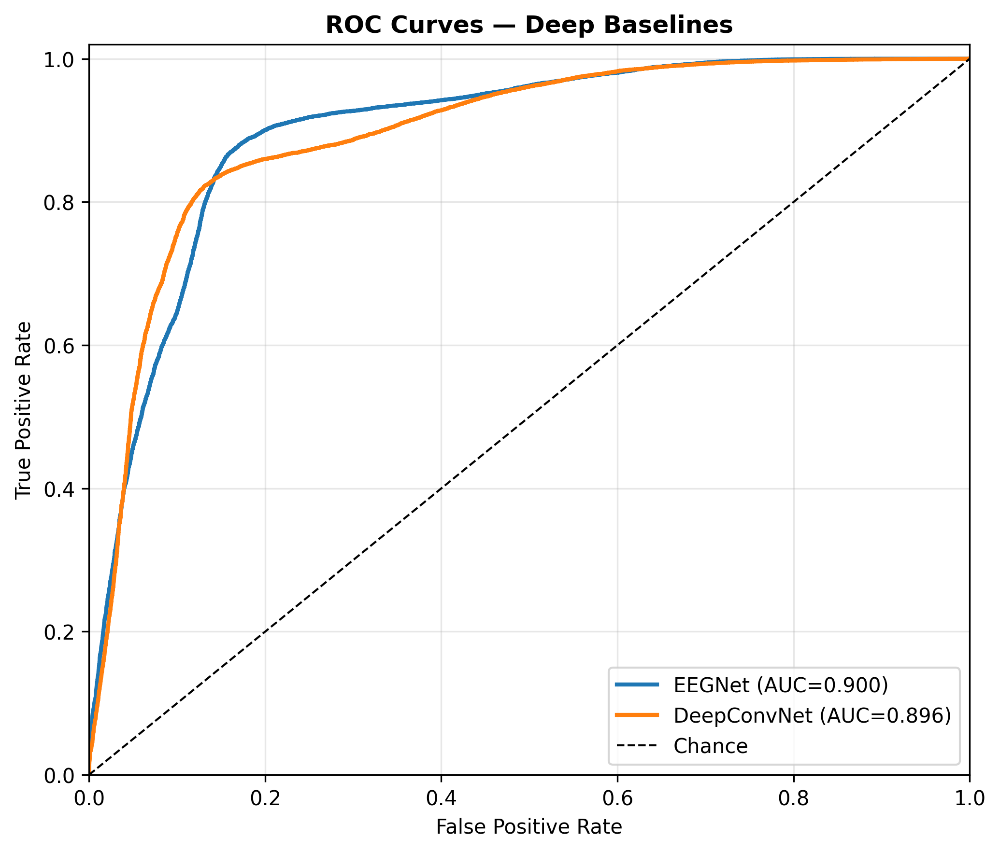
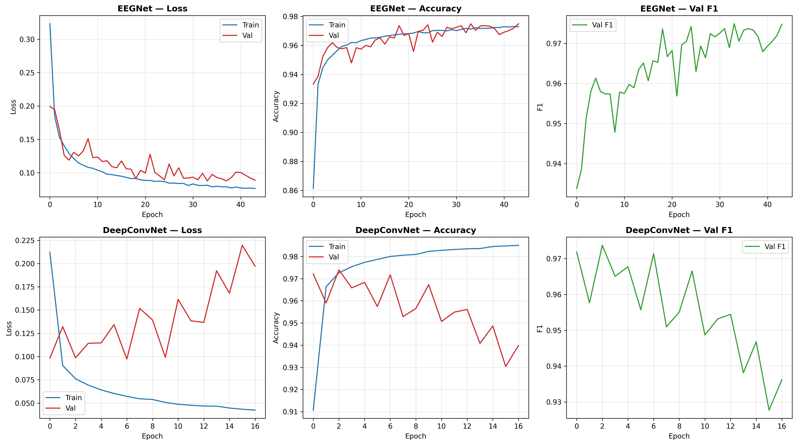
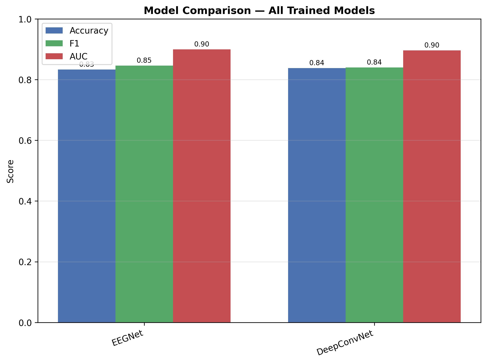
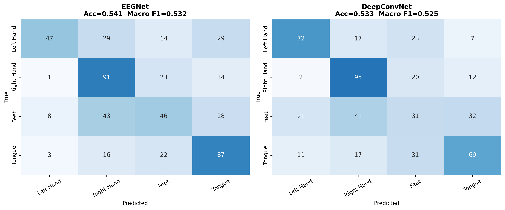
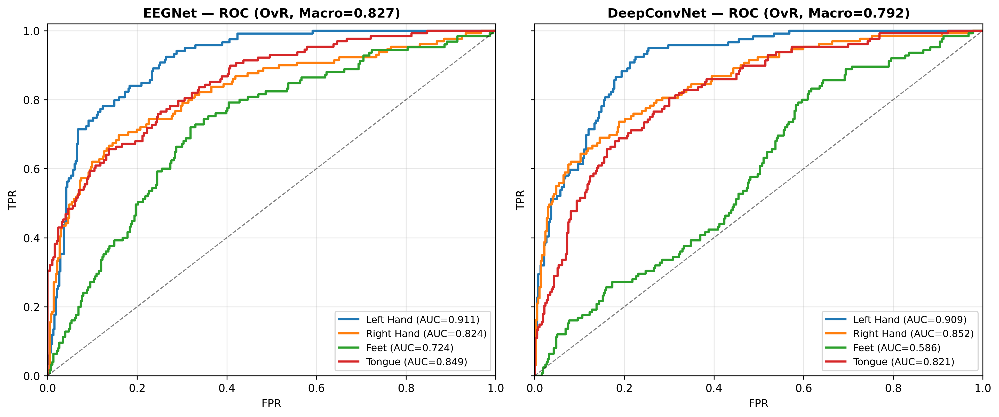
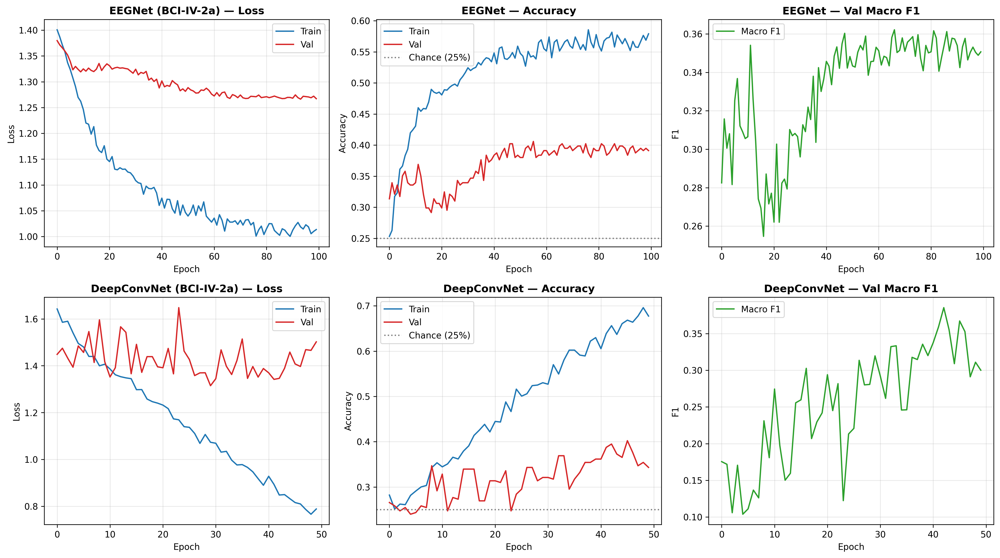
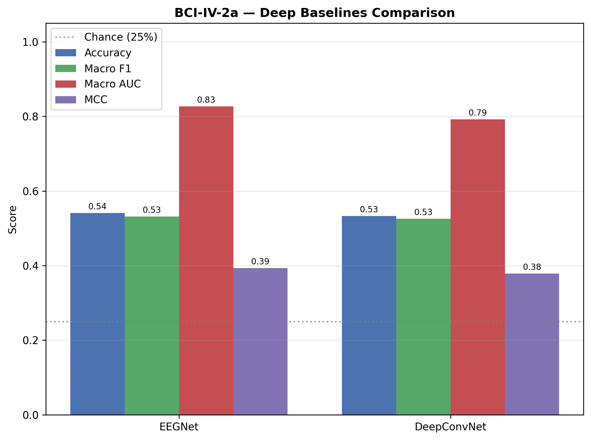

# LSTM-ODE-BCI: Deep Learning and Dynamical Modeling for EEG-Based Cognitive State Evolution

[](https://www.python.org/downloads/)
[](https://pytorch.org/)
[](https://opensource.org/licenses/MIT)

A novel unified framework integrating Long Short-Term Memory (LSTM) networks with a three-state compartmental Ordinary Differential Equation (ODE) model for interpretable cognitive state evolution in Brain-Computer Interfaces (BCIs).

## Overview

This repository contains the implementation for the paper:

> **Deep Learning and Dynamical Modeling Framework for EEG-Based Cognitive State Evolution in Brain-Computer Interfaces**
>
> Muhammad Khurram Umair¹*, Ayesha Arif², Muhammad Faisal Abrar³
>
> ¹University of Engineering and Technology, Peshawar, Pakistan
> ²National University of Sciences and Technology (NUST), Islamabad, Pakistan
> ³University of Hail, Saudi Arabia

## Key Features

- **LSTM-ODE Integration**: Probabilistic coupling between deep learning classification and mechanistic ODE dynamics
- **Three-State Cognitive Model**: Active, Passive, and Fatigued states with interpretable transition rates
- **Multi-Method Explainability**: Gradient-based attribution, permutation importance, and SHAP analysis
- **Comprehensive Pipeline**: From raw EEG preprocessing to model evaluation and visualization

## Architecture

```
┌─────────────────────────────────────────────────────────────┐
│                    EEG Input Sequence                       │
│                   (T × C) = 256 × 61                        │
└─────────────────────────┬───────────────────────────────────┘
                          │
                          ▼
┌─────────────────────────────────────────────────────────────┐
│                  Bidirectional LSTM                         │
│              (3 layers, 128 hidden units)                   │
└─────────────────────────┬───────────────────────────────────┘
                          │
                          ▼
┌─────────────────────────────────────────────────────────────┐
│                Self-Attention Pooling                       │
│                  (Temporal weighting)                       │
└─────────────────────────┬───────────────────────────────────┘
                          │
                          ▼
┌─────────────────────────────────────────────────────────────┐
│               Classification Head                           │
│            P(open), P(closed) → [0, 1]                      │
└─────────────────────────┬───────────────────────────────────┘
                          │
          ┌───────────────┴───────────────┐
          │   Probabilistic Coupling      │
          │   k'_AF = k_AF(1 + αP_closed) │
          │   k'_FA = k_FA(1 + αP_open)   │
          └───────────────┬───────────────┘
                          │
                          ▼
┌─────────────────────────────────────────────────────────────┐
│              Three-State ODE Model                          │
│         dA/dt, dP/dt, dF/dt (A + P + F = 1)                │
└─────────────────────────┬───────────────────────────────────┘
                          │
                          ▼
┌─────────────────────────────────────────────────────────────┐
│            Cognitive State Trajectory                       │
│              [Active, Passive, Fatigued]                    │
└─────────────────────────────────────────────────────────────┘
```

## Datasets

The framework is evaluated on two complementary EEG benchmarks.

### Dataset 1 — OpenNeuro ds004148 (binary: eyes open vs closed)

- **Source**: [OpenNeuro ds004148](https://openneuro.org/datasets/ds004148)
- **DOI**: 10.18112/openneuro.ds004148.v1.0.0
- **Participants**: 60 subjects (this study uses 30 with downloaded data)
- **Sessions**: 3 per participant
- **Channels**: 61 EEG channels (Brain Products, 64-electrode system)
- **Sampling Rate**: 500 Hz
- **Tasks**: Resting state — eyes open / eyes closed (binary classification)

Download via the provided helper script (only the eyes-open/closed
recordings, ~13 GB):

```bash
python download_dataset.py --yes
```

### Dataset 2 — BCI Competition IV, Dataset 2a (4-class motor imagery)

- **Source**: [Kaggle: bci-competition-iv-data-sets-2a](https://www.kaggle.com/datasets/thngdngvn/bci-competition-iv-data-sets-2a)
- **Reference**: [bbci.de/competition/iv/#dataset2a](https://www.bbci.de/competition/iv/#dataset2a)
- **Participants**: 9 subjects (A01–A09), training files (`*T.mat`)
- **Channels**: 22 EEG (+ 3 EOG, discarded) at 250 Hz
- **Trials**: 288 trials per subject (4-class motor imagery: left hand,
  right hand, feet, tongue)
- **Format**: MATLAB `.mat` (loaded with `scipy.io.loadmat`)

Manual download (Kaggle account required), then place all `*T.mat` files
into `archive (1)/` at the repo root:

```text
LSTM-ODE-BCI/
└── archive (1)/
    ├── A01T.mat
    ├── A02T.mat
    └── ... A09T.mat
```

> The `archive (1)/` directory is `.gitignored`; the dataset is not
> redistributed with this repository.

## Installation

### Requirements

- Python 3.10+
- PyTorch 2.0+
- CUDA 11.8+ (for GPU acceleration)

### Setup

```bash
# Clone repository
git clone https://github.com/khurrameycon/LSTM-ODE-BCI.git
cd LSTM-ODE-BCI

# Create virtual environment
python -m venv venv
source venv/bin/activate  # Linux/Mac
# or
venv\Scripts\activate  # Windows

# Install dependencies
pip install -r requirements.txt
```

### Dependencies

```
torch>=2.0.0
numpy>=1.24.0
pandas>=2.0.0
scikit-learn>=1.3.0
scipy>=1.11.0
matplotlib>=3.7.0
seaborn>=0.12.0
mne>=1.5.0
shap>=0.42.0
tqdm>=4.65.0
xgboost>=2.0.0
```

## Project Structure

```
LSTM-ODE-BCI/
├── 01_data_exploration.py      # Dataset exploration and statistics
├── 02_preprocessing.py         # EEG preprocessing pipeline
├── 03_baseline_models.py       # SVM, Random Forest, XGBoost baselines
├── 04_lstm_model.py            # Enhanced LSTM with attention
├── 05_ode_model.py             # Three-state cognitive ODE model
├── 06_lstm_ode_integration.py  # Unified LSTM-ODE framework
├── 07_explainability.py        # Gradient, permutation, SHAP analysis
├── 08_forecasting.py           # State trajectory forecasting
├── 09_sensitivity_analysis.py  # Ablation studies
├── 10_three_state_probabilities.py   # Per-participant 3-state probabilities
├── 11_deep_baselines.py              # EEGNet + DeepConvNet on ds004148 (binary)
├── 02b_preprocessing_bciiv2a.py      # BCI-IV-2a preprocessing (.mat → npz)
├── 12_deep_baselines_bciiv2a.py      # EEGNet + DeepConvNet on BCI-IV-2a (4-class MI)
├── regenerate_deep_baseline_plots.py # Re-emit fig26-33 from saved JSON (headless)
├── download_dataset.py               # ds004148 download utility
├── archive (1)/                      # BCI-IV-2a .mat files (A01T-A09T, manually downloaded)
├── requirements.txt                  # Python dependencies
└── README.md                         # This file
```

## Usage

### 1. Data Exploration

```bash
python 01_data_exploration.py
```

Generates dataset statistics, channel distributions, and temporal patterns.

### 2. Preprocessing

```bash
python 02_preprocessing.py
```

Applies bandpass filtering (1-45 Hz), z-score normalization, and sequence creation.

### 3. Baseline Models

```bash
python 03_baseline_models.py
```

Trains and evaluates SVM, Random Forest, and XGBoost classifiers.

### 4. LSTM Training

```bash
python 04_lstm_model.py
```

Trains the enhanced LSTM with attention mechanism.

### 5. ODE Model Fitting

```bash
python 05_ode_model.py
```

Fits the three-state cognitive ODE parameters.

### 6. LSTM-ODE Integration

```bash
python 06_lstm_ode_integration.py
```

Combines LSTM and ODE with probabilistic coupling.

### 7. Explainability Analysis

```bash
python 07_explainability.py
# Or skip SHAP (faster):
python 07_explainability.py --skip-shap
```

Computes channel importance using multiple methods.

### 8. Deep Learning Baselines — ds004148 (EEGNet, DeepConvNet)

```bash
python 11_deep_baselines.py
```

Trains EEGNet (Lawhern et al., 2018) and DeepConvNet (Schirrmeister et al., 2017)
on the same preprocessed sequences used by the LSTM, then writes confusion
matrices, ROC curves, training histories, and a comparison bar chart
(`fig26`–`fig29`). If matplotlib's interactive backend fails on a headless
machine, regenerate the figures from the saved JSON with:

```bash
python regenerate_deep_baseline_plots.py ds004148
```

### 9. Second Dataset — BCI Competition IV, Dataset 2a (4-class Motor Imagery)

Drop the manually downloaded `.mat` files (`A01T.mat` … `A09T.mat`) into
`archive (1)/`, then:

```bash
python 02b_preprocessing_bciiv2a.py    # produces bciiv2a_sequences.npz
python 12_deep_baselines_bciiv2a.py    # trains EEGNet + DeepConvNet (4-class)
# Headless fallback:
python regenerate_deep_baseline_plots.py bciiv2a
```

Outputs `fig30`–`fig33` (training history, confusion matrices, per-class
one-vs-rest ROC curves, comparison bar chart with the 25% chance line).

## Results

### Dataset 1 — ds004148 (Binary: Eyes Open vs Closed)

| Model | Accuracy | F1-Score | AUC |
|-------|----------|----------|-----|
| SVM | 38.0% | 0.000 | 0.467 |
| Random Forest | 60.3% | 0.563 | 0.657 |
| XGBoost | 62.0% | 0.632 | 0.689 |
| LSTM-Attention | 54.9% | 0.603 | 0.596 |
| LSTM-ODE | 54.9% | 0.599 | 0.596 |
| **EEGNet** | **83.3%** | **0.846** | **0.900** |
| **DeepConvNet** | **83.8%** | **0.840** | **0.896** |

EEGNet and DeepConvNet were trained on the *same* train/val/test split as
the LSTM (subject-wise, 21/4/5 subjects, 256-sample windows, 50 epochs,
class-weighted cross-entropy, Adam + cosine schedule).

<p align="center">
  
  <br/>
  <em>Confusion matrices — EEGNet vs DeepConvNet on the ds004148 test set.</em>
</p>

<p align="center">
  
  <br/>
  <em>ROC curves — both models reach AUC ≈ 0.90.</em>
</p>

<p align="center">
  
  <br/>
  <em>Training history (loss · accuracy · validation F1) for each model.</em>
</p>

<p align="center">
  
</p>

### Dataset 2 — BCI-IV-2a (4-class Motor Imagery, subject-independent)

Train: A01–A06 (1,556 trials)  ·  Val: A07 (271)  ·  Test: A08–A09 (501).
Chance accuracy = 25%.

| Model | Accuracy | Macro F1 | Macro AUC (OvR) | MCC |
|-------|----------|----------|------------------|-----|
| EEGNet | 54.1% | 0.532 | 0.827 | 0.393 |
| DeepConvNet | 53.3% | 0.525 | 0.792 | 0.379 |

Per-class AUC shows *Feet* as the hardest class (EEGNet 0.72, DeepConvNet
0.59) — consistent with the published BCI-IV-2a literature.

<p align="center">
  
  <br/>
  <em>4×4 confusion matrices (normalized by true class) on the BCI-IV-2a test set (A08 + A09).</em>
</p>

<p align="center">
  
  <br/>
  <em>One-vs-rest ROC curves per motor-imagery class.</em>
</p>

<p align="center">
  
  <br/>
  <em>Training dynamics on BCI-IV-2a — note the chance line (25 %) on the accuracy panel.</em>
</p>

<p align="center">
  
</p>

### Learned ODE Parameters

| Transition | Rate | Time Constant | Interpretation |
|------------|------|---------------|----------------|
| Passive → Fatigued | 0.626 | 1.6s | Rapid fatigue onset |
| Fatigued → Active | 0.139 | 7.2s | Slower recovery |
| Active → Fatigued | 0.095 | 10.6s | Gradual fatigue |
| Active → Passive | 0.020 | 50.4s | Slow disengagement |

## Citation

If you use this code in your research, please cite:

```bibtex
@article{umair2024lstmode,
  title={Deep Learning and Dynamical Modeling Framework for EEG-Based
         Cognitive State Evolution in Brain-Computer Interfaces},
  author={Umair, Muhammad Khurram and Arif, Ayesha and Abrar, Muhammad Faisal},
  journal={Journal of Healthcare Informatics Research},
  year={2024},
  publisher={Springer}
}
```

## License

This project is licensed under the MIT License - see the [LICENSE](LICENSE) file for details.

## Acknowledgments

- OpenNeuro for hosting the ds004148 dataset
- University of Engineering and Technology, Peshawar
- National University of Sciences and Technology (NUST), Islamabad
- University of Hail, Saudi Arabia

## Contact

- **Muhammad Khurram Umair** - khurram.umair@uetpeshawar.edu.pk
- **Ayesha Arif** - ayesha.arif@nust.edu.pk
- **Muhammad Faisal Abrar** - mfabrar@uoh.edu.sa
